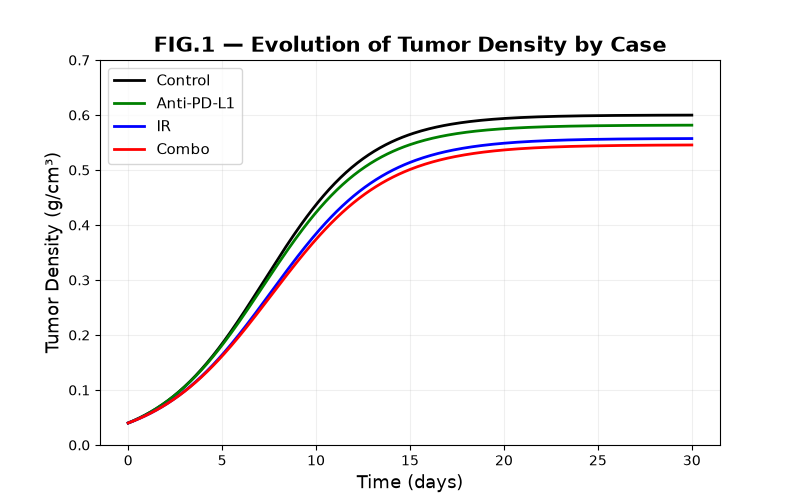
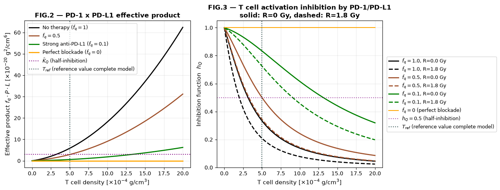

# Tumor-immune ODE model: radiotherapy and anti-PD-L1

Python implementation of a **two-variable ODE model** of the tumor microenvironment. It compares how radiotherapy (IR)
and anti-PD-L1 immunotherapy, alone and combined, affect tumor growth under pressure from CD8+ T cells, and shows how the
PD-1/PD-L1 checkpoint inhibits T-cell activation.

The model is a reduced version of the six-variable model of Liao, Wieler & Lopez Gascon (2024) [1]. Dendritic cells,
M2 macrophages and regulatory T cells are held constant at their reference values (the wild-type steady states of Eq. 2.15
of [1]), and TGF-β is dropped because in [1] it only acts on those two populations. **The equations and all parameter values
come from [1].** This repository is an independent re-implementation for educational purposes: it is not affiliated with the
authors, reproduces no figure or text from the article, and is not meant for clinical use.

Course project for *Modeling and quantitative approaches to life science* (MSc, first year).

## Model

Tumor cells `C` and CD8+ T cells `T`, in g/cm³; time in days (Eqs. 2.1, 2.4, 2.7, 2.9 and 2.14 of [1]):

```
dC/dt = λ_C C (1 − C/C̃) − η_T T C − η_R R C − d_C C
dT/dt = λ_T T_h · D*/(K_D + D*) · h_M2 · h_Tr · h_Q − (d_T + μ_TR R) T

h_M2 = 1 / (1 + M2*/K̄_M2)      h_Tr = 1 / (1 + Tr*/K̄_Tr)      h_Q = 1 / (1 + f_q · P·L / K̄_Q)
P = ρ_P T                       L = ρ_L (T + ε M2* + ε C)(1 + λ_LR R)
```

- **Treatments.** `R` is the radiation dosage (Gy); it kills tumor cells (`η_R`) and T cells (`μ_TR`) and increases PD-L1
  expression (`λ_LR`). `f_q` is the anti-PD-L1 efficacy: `f_q = 1` means no drug, smaller values mean stronger blockade.
- **Scenarios** (Sect. 3.1 of [1]), applied continuously for 30 days: Control (`R = 0`, `f_q = 1`), Anti-PD-L1 (`R = 0`,
  `f_q = 0.1`), IR (`R = 1.8` Gy, `f_q = 1`), Combo (`R = 1.8` Gy, `f_q = 0.1`). In [1] this continuous low dose is a
  simplification of the experiment of [2] (12 Gy once, anti-PD-L1 on four days).
- **Parameters:** Table 1 of [1]; nothing is fitted here. Table 1 gives `μ_TR = 0.06367` /Gy/day while Appendix A.10 of [1]
  derives 0.06: the Table 1 value is used (with 0.06 the curves are visually indistinguishable).
- **Initial conditions:** `C(0) = 0.1 C*` and `T(0) = 0.1 T*`, with `C* = 0.4` and `T* = 5·10⁻⁴` g/cm³ (Eq. 2.15 of [1]).
- **Numerical method:** explicit Runge-Kutta 4(5) (`scipy.integrate.solve_ivp`, `atol = 1e-10`, `rtol = 1e-7`).
- **Modeling assumption.** [1] writes the PD-1/PD-L1 complex as proportional to `P·L` (Eq. 2.11) and absorbs the constant of
  proportionality in `K̄_Q` (Eq. 2.12). This project adopts that assumption; it does not test it.

## Results

### Tumor density in the four scenarios



| Scenario | R (Gy) | f_q | Tumor density at day 30 (g/cm³, read from the figure) |
|---|---|---|---|
| Control | 0 | 1.0 | ≈ 0.60 |
| Anti-PD-L1 | 0 | 0.1 | ≈ 0.58 |
| IR | 1.8 | 1.0 | ≈ 0.56 |
| Combo | 1.8 | 0.1 | ≈ 0.55 |

- The ordering is Control > Anti-PD-L1 > IR > Combo. Anti-PD-L1 alone gives a small reduction, IR alone a larger one, and the
  combination lies only slightly below IR alone.
- All curves are flat by day 30: extending `tmax` in `plot_tumor_dynamics()` (e.g. to 300 days) leaves the plateaus visually
  unchanged. In none of the four scenarios is the tumor eliminated.

### PD-1/PD-L1 term and T-cell inhibition



Left: the effective product `f_q · P · L` against T-cell density, compared with the half-inhibition constant `K̄_Q`.
Right: the inhibition function `h_Q` (solid: no radiation, dashed: 1.8 Gy). Both panels are drawn at the reference tumor
density `C = 0.4 g/cm³`; the dotted vertical line is the reference T-cell density `T_ref = T* = 5·10⁻⁴ g/cm³`.
Values below are read from the figure.

- Without therapy, `P·L` at `T_ref` is about twice `K̄_Q`, so `h_Q ≈ 0.33`: T-cell activation is already strongly inhibited.
  The no-therapy curve crosses the half-inhibition level (`h_Q = 0.5`) at about `T = 3·10⁻⁴ g/cm³`, below `T_ref`.
- Radiation lowers `h_Q` (to ≈ 0.21 at `T_ref`) because it increases PD-L1 expression.
- Anti-PD-L1 raises `h_Q`: at `T_ref` it is 0.5 for `f_q = 0.5` and ≈ 0.83 for `f_q = 0.1`; combined with radiation,
  `f_q = 0.1` gives `h_Q ≈ 0.7`, against ≈ 0.21 with radiation alone. With `f_q = 0` there is no inhibition (`h_Q = 1`).

## Assumptions and limitations

- **Reference state.** `C*`, `T*` and the frozen values `D*`, `M2*`, `Tr*` (Eq. 2.15 of [1]) describe the wild-type reference
  state used in [1] to calibrate the parameters. In that state the tumor is still growing (growth rate `λ₀ = 0.12 day⁻¹`,
  Appendix A.11 of [1]), so `C* = 0.4` is *not* an equilibrium of the model: the control curve settles at about 0.60 g/cm³.
  Figures 2-3 are drawn at the reference `C = 0.4`; at `C = 0.6`, `h_Q` at `T_ref` without therapy would be ≈ 0.29 instead of
  ≈ 0.33 (change `C_ref` in `plot_pdl1_analysis()` to check).
- **Frozen variables.** Here `D`, `M2` and `Tr` are constant from `t = 0` at 100% of their reference values. In [1] they are
  dynamic variables that start at 10% of those values (Eq. 2.15), are killed by radiation (Eqs. 2.2, 2.3 and 2.5) and, for `Tr`,
  are promoted by PD-1/PD-L1 (Eq. 2.5). These feedbacks are absent here, and their effect on the results was not quantified.
- **Parameters.** Several parameters were chosen by the authors of [1] so that simulations reproduce qualitatively the
  experiments of [2] (entries marked "Chosen for S.O." in Table 1 of [1], i.e. selected to fit the experimental data qualitatively: e.g. `f_q`, `λ_LR`, `ε`, `K̄_M2`, `K̄_Tr`, `K̄_Q`).
  The ordering of the scenarios obtained here is therefore not an independent validation of the model.
- **Constant therapy and plateau.** IR and anti-PD-L1 act at a constant level (a simplification of [1]; discrete schedules are
  not modeled). The plateau follows from parameters estimated at steady state (limitation (ii) in Sect. 6 of [1]) and should
  not be read as a prediction of long-term tumor control. The persistence of the tumor is consistent with the parameters:
  the growth rate `λ_C = 0.5436 day⁻¹` is much larger than `d_C + η_R R = 0.17 + 0.016557 × 1.8 day⁻¹`.
- The T-cell density `T(t)` is integrated together with the tumor, but only the tumor density is plotted.

## Run it

Requirements: Python 3 with NumPy, SciPy and Matplotlib (tested with Python 3.12).

Download the repository (green **Code** button → *Download ZIP*) or clone it, then, from the main folder:

```bash
pip install -r requirements.txt
python ode_model.py
```

It takes a few seconds and prints

```
Simulation...
Fig. 1 saved.
Fig. 2 and fig. 3 saved.
Simulation completed. Check the 'figures' folder.
```

The two figures are written to `figures/`, overwriting the ones in the repository. Run the command from the main folder: `figures/`
is created in the folder from which it is launched.

## Repository structure

```
ode_model.py     model, simulations and figures
figures/             figures produced by the script
requirements.txt     Python dependencies
```

## References

[1] Liao K.-L., Wieler A.J., Lopez Gascon P.M. (2024). Mathematical modeling and analysis of cancer treatment with radiation and anti-PD-L1. *Mathematical Biosciences* 374, 109218. https://doi.org/10.1016/j.mbs.2024.109218

[2] Deng L., Liang H., Burnette B., Beckett M., Darga T., Weichselbaum R.R., Fu Y.-X. (2014). Irradiation and anti-PD-L1 treatment synergistically promote antitumor immunity in mice. *Journal of Clinical Investigation* 124(2), 687-695. https://doi.org/10.1172/JCI67313


## Author 

Isaia Sproloquio. The articles [1] and [2] are not part of this repository and remain subject to their publisher's copyright.
